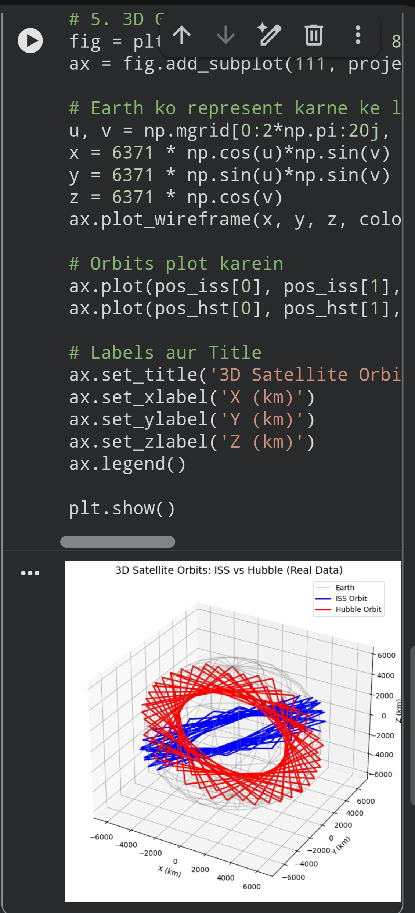
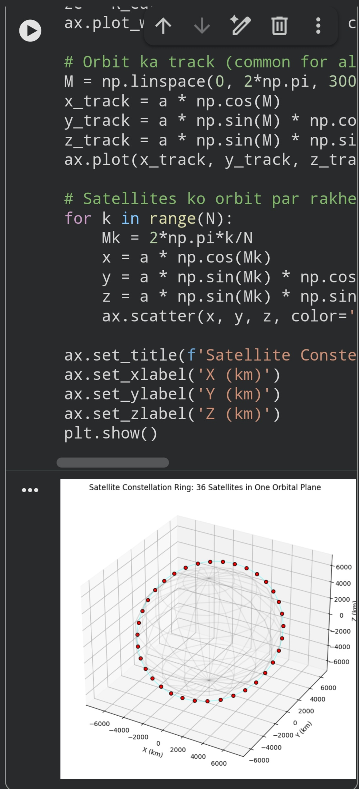
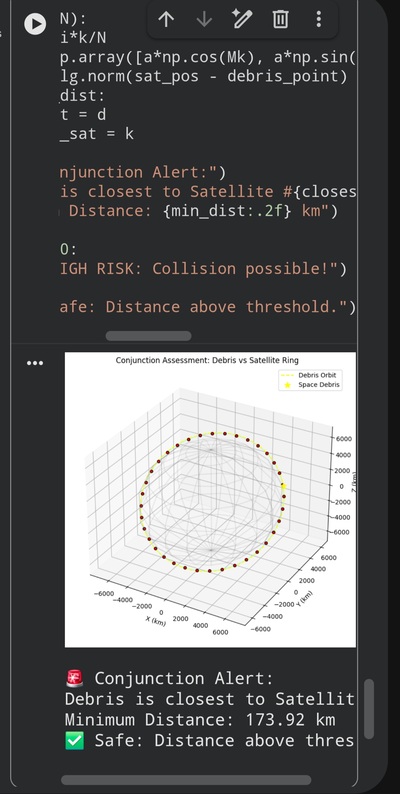
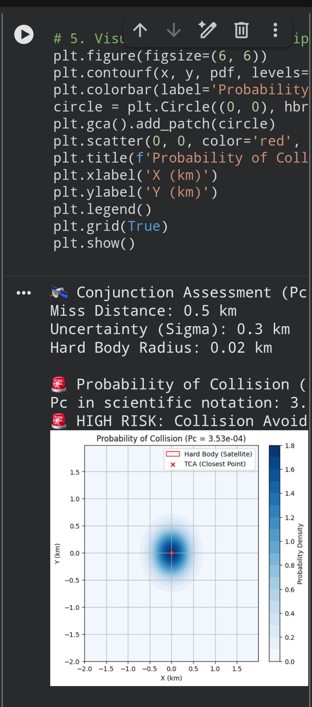

[](https://github.com/kumarmaheshbly-oss/Project-Aura)
# Project Aura: Real-Time Collision Avoidance

A Python simulation for a distributed satellite swarm with **REAL orbital data** from Space-Track (US Space Force).

## Features
[Satellite Ring]
## 📸 Visual Results

### 1. 3D Orbit Visualization


### 2. Constellation Ring Simulation


### 3. Conjunction Assessment


### 4. Probability of Collision (Foster-1992)

- **Real Data Analysis:** Uses live TLE data from Space-Track.org (US Space Force)
- Calculates Time-to-Closest-Approach (TCA)
- Calculates Distance of Closest Approach (DCA)
- Simulates 2-second reaction latency
- Executes autonomous avoidance maneuvers
- Magnetic docking simulation with eddy current damping
- Post-maneuver safety verification
- **Scaled Analysis:** 123 satellites with two-stage pipeline and parallel processing (0.03 sec computation time)
- Scaled Analysis: 499 satellites with two-stage pipeline, parallel processing, and Pc calculation with Monte Carlo uncertainty
## Files

- `collision_avoidance.py` — Simulated 5-satellite collision avoidance with magnetic docking
- `real_leo_analysis.py` — Real LEO satellite collision analysis using live TLE data from Space-Track
- `pc_monte_carlo.py` — Probability of Collision (Pc) with Monte Carlo uncertainty (NASA CARA)
- `space_tcp_ip_simulation.py` — Autonomous satellite negotiation without ground control
- `499_satellites_analysis.py` — 499-satellite collision analysis (3 close approaches detected)
## Data Source

Live satellite data from [Space-Track.org](https://www.space-track.org) — US Space Force (S4S) and CFSCC.

## How to Run

```bash
pip install sgp4
python real_leo_analysis.py
```
## 📸 Visual Results

### 1. 3D Orbit Visualization (ISS vs Hubble - Real TLE Data)


### 2. Constellation Ring (Walker Delta - 36 Satellites)


### 3. Conjunction Assessment (Debris vs Ring)


### 4. Probability of Collision (Foster-1992 Method)

